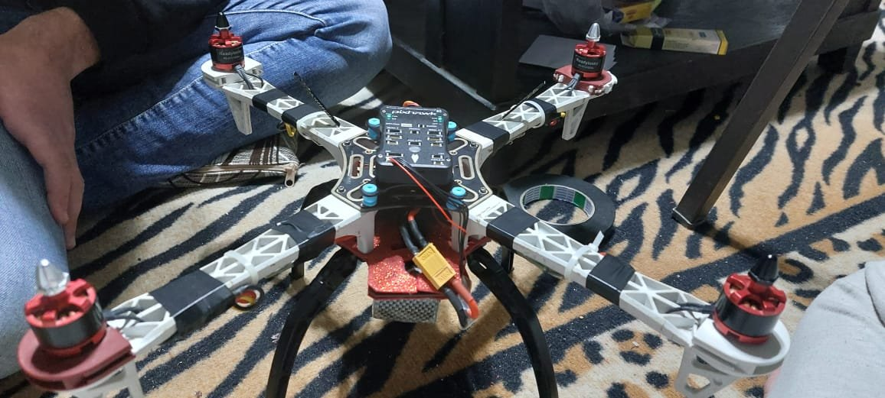
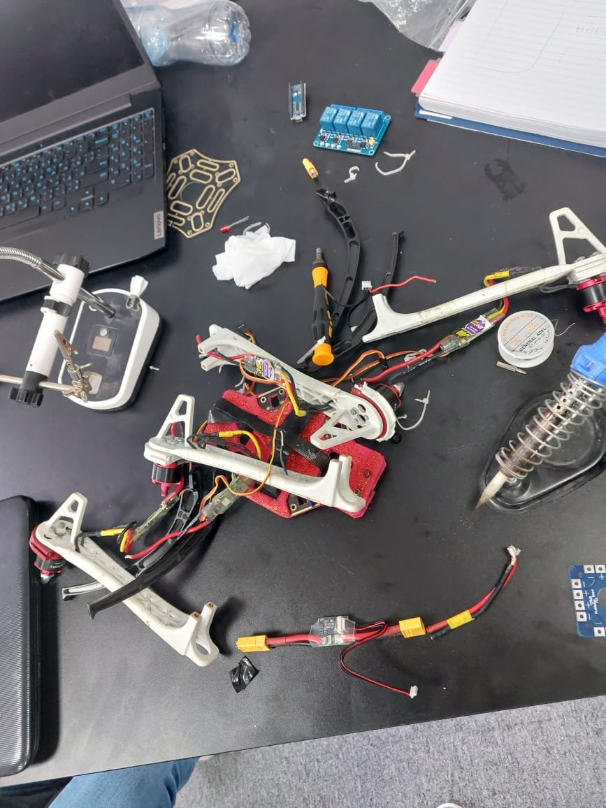
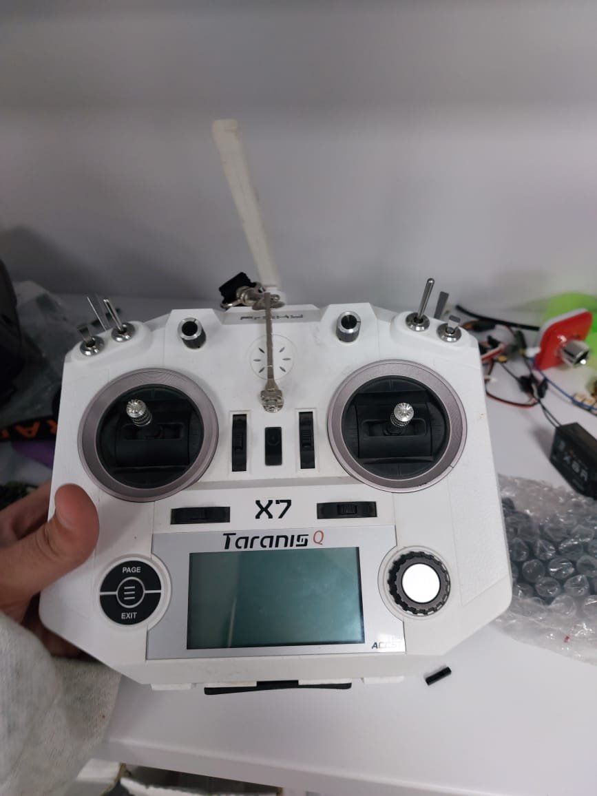

# Wraith UAV

A quadcopter I built in 2022 for my Computer Organization course. It runs ArduPilot on a Pixhawk flight controller, is configured through Mission Planner, and was set up to take commands from a Raspberry Pi over MAVLink.

This repository documents the build: the parts, how they were configured, what went wrong, and the small test script we used to check the Pi-to-Pixhawk link.



## Contents

- [Overview](#overview)
- [Hardware](#hardware)
- [Build photos](#build-photos)
- [Configuration](#configuration)
- [Failsafe design](#failsafe-design)
- [Challenges](#challenges)
- [Test script](#test-script)
- [Repository layout](#repository-layout)
- [References](#references)

## Overview

Unmanned aerial vehicles (UAVs), also known as drones, are aircraft controlled remotely or autonomously without a human pilot onboard. They can operate in hazardous environments and collect data with sensors and cameras.

The project covers building a multirotor from separate components, configuring it for manual flight, and connecting a Raspberry Pi to the Pixhawk through MAVProxy.

**Why Pixhawk?** It is a widely used, well-tested flight controller with a large community and a lot of documentation. It integrates the sensors and peripherals needed for flight, and it runs ArduPilot.

**Why Mission Planner?** It is the ground control software for ArduPilot vehicles. It is used here for firmware setup, calibration, parameter changes, and monitoring.

## Hardware

| Part | Used |
| --- | --- |
| Flight controller | Pixhawk (ArduPilot firmware) |
| Frame | Quadcopter |
| Motors | 4 × Readytosky 920kv |
| Battery | LiPo, 11.1V (3S), 3300 mAh |
| Power distribution | Power distribution board |
| Radio | FrSky Taranis X7 |
| Receiver | FrSky X8R |
| ESCs | One per motor |
| Companion computer | Raspberry Pi |
| Ground control | Mission Planner |

**ESCs.** The electronic speed controllers drive the motors, adjusting their speed based on commands from the flight controller.

**Frame.** A quadcopter was chosen for its simplicity and ease of use. The design was modified to fit the components that were available while keeping the original connections.

### Motors and propellers


### Battery and power distribution


### Radio control


### ESCs


### Frame


### Basic design


## Build photos

<p>
  
  
</p>

Left: the build in progress. Right: the Taranis X7 transmitter.

## Configuration

Everything below was done in Mission Planner.


### Radio calibration

Radio calibration maps the transmitter's sticks and switches to the flight controller's inputs, so the stick positions it reads match what the transmitter sends.


### Parameters

Setting `ARMING_CHECK` to `0` turns off the pre-arm checks, including the GPS check, so the drone can be armed without a GPS lock. This was used so the drone could be tested without GPS. Pre-arm checks exist for safety, so only do this for bench or indoor testing and put the checks back before flying outdoors.


### Flight modes

Three flight modes were configured:

1. **Stabilize:** the pilot controls the drone's angle and the flight controller levels it when the sticks are centered. Throttle is manual.
2. **AltHold (Altitude Hold):** like Stabilize, but the flight controller also holds altitude. Throttle stick controls climb and descent rate.
3. **Acro (Acrobatics):** the sticks control rotation rate and the drone does not self-level, which allows flips and agile manoeuvres.


### ESC calibration

The settings for good ESC performance were found by trying different combinations.


## Failsafe design

A battery failsafe starts a Return to Launch (RTL) sequence if battery voltage drops below 7.5V, so the drone returns and lands safely.


## Challenges

**No MAVProxy heartbeat.** The Raspberry Pi could not connect to the Pixhawk, because MAVProxy was not receiving a heartbeat from the flight controller. The cause turned out to be the Pixhawk board itself, a hardware fault. Once it was swapped for another one, the connection worked and the rest of the build went smoothly.

**Lesson:** when a link won't come up and the configuration looks right, rule out the hardware early.


## Test script

[`takeoffAndLand.py`](takeoffAndLand.py) is the script we hoped to use to test that the MAVProxy connection was established. It uses [DroneKit](https://dronekit-python.readthedocs.io/) to:

1. Connect to the vehicle with the address passed as `--connect`.
2. Switch to `GUIDED` mode and wait until the vehicle reports it is armable.
3. Take off to a target altitude of 2 m and wait until it reaches 95% of it.
4. Switch to `LAND` mode and print the ArduCopter version.

Usage:

```bash
pip install dronekit
python takeoffAndLand.py --connect <connection string>
```

`<connection string>` is whatever address your MAVProxy or flight controller connection exposes, for example a MAVProxy UDP output. Remove the propellers and test on the bench first.

## Repository layout

```
.
├── README.md            this documentation
├── takeoffAndLand.py    DroneKit connection test: takeoff to 2 m, then land
├── images/              photos of the build
└── LICENSE              MIT
```

## References

- [The Drone Dojo](https://www.youtube.com/@thedronedojo3624)
- [YouTube: How to Build a Drone](https://www.youtube.com/watch?v=qmxEx28N56s)
- [YouTube: Drone Programming](https://www.youtube.com/watch?v=2Rikb6hRl5g)
- [YouTube: ArduPilot playlist](https://www.youtube.com/playlist?list=PLk5osPy4f_U8Muv7KwCvg5C5wtEcCIjjf)
- [ArduPilot: Mission Planner](https://ardupilot.org/planner/docs/common-connect-mission-planner-autopilot.html)
- [ArduPilot: Copter documentation](https://ardupilot.org/copter/)
- [MAVProxy documentation](https://ardupilot.org/mavproxy/)
- [DroneKit-Python documentation](https://dronekit-python.readthedocs.io/)

## License

MIT, see [LICENSE](LICENSE).

For questions, open an issue on this repository.
